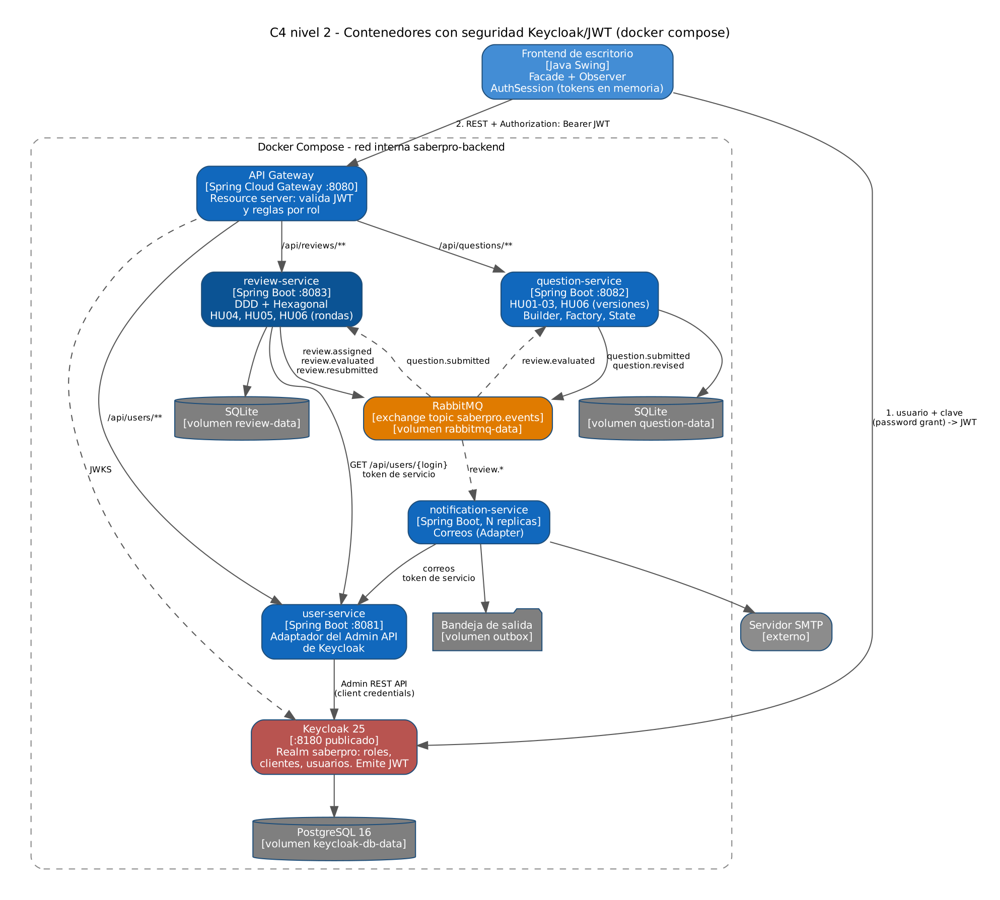

# Banco de Preguntas Saber PRO

Sistema para que docentes construyan preguntas tipo Saber PRO (selección múltiple con única respuesta, Diseño Centrado en Evidencia), las sometan a **revisión por pares** y las corrijan por **versiones** hasta que sean aprobadas.

Proyecto de **Ingeniería de Software II** (Universidad del Cauca, 2026.2), construido en tres iteraciones: monolito en capas → microservicios orientados a eventos → **microservicios seguros con Keycloak/JWT, arquitectura limpia (DDD + hexagonal) y despliegue con Docker Compose**.

     

---

## Qué hace

| HU | Rol | Funcionalidad |
|----|-----|---------------|
| HU01 | Autor | Crear preguntas con validación estructural completa (400 con todos los errores juntos) |
| HU02 | Autor | Enviar a revisión (Borrador → Pendiente), estados con colores |
| HU03 | Autor | Listar, buscar, filtrar, paginar y editar sus borradores |
| HU04 | Administrador | Asignar de 1 a 3 revisores; correo a cada revisor |
| HU05 | Revisor | Ver sus asignaciones, aprobar o rechazar con observaciones; notificación al autor y administradores |
| **HU06** | Autor | **Historial de revisiones** (una ronda por versión, con observaciones), **versión mejorada** de una pregunta rechazada y nueva ronda de revisión; notificación a los implicados |

## Arquitectura



```
 Frontend Swing ──(1) usuario/clave──> Keycloak :8180 ──> JWT firmado (roles, aud=saberpro-api)
       │
       └──(2) REST + Bearer JWT──> API Gateway :8080 (valida JWT + roles)
                                       ├──> user-service        (adaptador del Admin API de Keycloak)
                                       ├──> question-service    (HU01-03, versiones HU06)        ── SQLite [volumen]
                                       └──> review-service      (HU04-06, DDD + hexagonal)       ── SQLite [volumen]
 question-service ─┐                                    ┌──> review-service        question.submitted
 review-service   ─┴──> RabbitMQ (saberpro.events) ─────┼──> question-service      review.evaluated
                                                        └──> notification-service  review.assigned / evaluated / resubmitted
```

- **Microservicios** con base de datos propia, comunicados por **REST** (consultas) y **eventos en RabbitMQ** (cambios).
- **Seguridad:** Keycloak emite los tokens; el gateway y cada servicio validan firma, emisor, audiencia y vigencia (*defensa en profundidad*); autorización por rol con `@PreAuthorize` y por reglas de dominio. Los servicios se llaman entre sí con un **token de servicio** (*client credentials*). El usuario de cada operación sale **del token**, nunca del cuerpo JSON.
- **Arquitectura limpia en el review-service:** agregado `QuestionReview` (rondas, asignaciones, evaluaciones) cuyo estado solo cambia con métodos de negocio; puertos de entrada/salida y adaptadores (REST, RabbitMQ, SQLite, HTTP). La regla de dependencias se verifica con **ArchUnit** en cada build.

| Módulo | Contenido |
|--------|-----------|
| `common` | Contratos compartidos (eventos, enums, `ApiError`), bus de eventos (Observer) y **seguridad compartida** (resource server JWT, convertidor de roles de Keycloak, token de servicio). |
| `user-service` | Consulta y registro de usuarios sobre el **Admin REST API de Keycloak** (sin contraseñas propias). |
| `question-service` | Preguntas: Builder, Factory Method, Tuberías y Filtros, **State**; versiones archivadas (HU06). |
| `review-service` | Revisión por pares con **DDD + hexagonal**: `domain`, `application/port/{in,out}`, `application/service`, `infrastructure/adapter/{in,out}`. |
| `notification-service` | Correos (Adapter SMTP / bandeja en archivo); escala con réplicas. |
| `api-gateway` | Spring Cloud Gateway: única entrada, validación JWT, Swagger UI unificado. |
| `frontend` | Cliente Swing: login con Keycloak, `Bearer` en cada petición, renovación del token, pantallas por rol. |
| `keycloak/` | Realm `saberpro` (roles, clientes, usuarios de prueba) que se importa solo. |

## Ejecutar

Requisito: **Docker** (Docker Desktop o Docker Engine con Compose v2). No hace falta Maven ni JDK para el backend.

```bash
git clone https://github.com/martinezgrasantiago214/BANCO_PREGUNTAS_SABER_PRO.git
cd BANCO_PREGUNTAS_SABER_PRO
docker compose up --build -d      # la primera vez tarda unos minutos (descarga y compila)
docker compose ps                 # esperar a que todo quede "healthy"
```

| Recurso | URL | Credenciales |
|---------|-----|--------------|
| API Gateway + Swagger UI (botón *Authorize*) | http://localhost:8080/swagger-ui.html | token JWT |
| Consola de Keycloak | http://localhost:8180/admin | `admin` / `admin` |
| Consola de RabbitMQ | http://localhost:15672 | `guest` / `guest` |

**Usuarios de prueba** (realm `saberpro`): `admin/Admin123!` (administrador), `autor1/Autor123!` y `autor2/Autor123!` (autores), `rev1`, `rev2`, `rev3` con `Revisor123!` (revisores).

**Frontend de escritorio** (requiere JDK 17 y Maven):

```bash
mvn -pl frontend -am package -DskipTests
java -jar frontend/target/frontend-3.0.0.jar
# otras URLs: -Dsaberpro.gateway.url=http://host:8080 -Dsaberpro.keycloak.url=http://host:8180
```

**Postman:** importar `postman/BancoPreguntas-API.postman_collection.json` y ejecutarla en orden (56 peticiones con aserciones): tokens por rol, gestión de usuarios y roles en Keycloak, pruebas de seguridad (401/403) y el flujo completo HU01 → HU06.

**Desarrollo desde el IDE:** `docker compose up -d keycloak rabbitmq` y luego el compound *"Banco de Preguntas (todo el sistema)"* de `.vscode/launch.json`.

Otros comandos útiles:

```bash
docker compose up -d --scale notification-service=3   # escalar los consumidores de correo
docker compose logs -f review-service
docker compose down        # apaga; los datos quedan en los volúmenes
docker compose down -v     # apaga y borra los volúmenes (vuelve a importar el realm)
```

Para cambiar secretos y contraseñas, copiar `.env.example` como `.env`.

## Pruebas

```bash
mvn test     # 247 pruebas JUnit 5; no necesitan Keycloak, RabbitMQ ni SMTP
```

Cubren las entidades y servicios de dominio de cada microservicio (agregado `QuestionReview`, objetos de valor, `Question` con versiones y estados, fábricas, filtros, usuarios), los casos de uso con dobles de los puertos, los repositorios SQLite, los códigos HTTP de los controladores (usuario simulado del token), el cliente de Keycloak del frontend y la regla de dependencias hexagonal (ArchUnit).

## Patrones de diseño

| Tipo | Patrones |
|------|----------|
| GoF creacionales | Builder (`Question`), Factory Method (`QuestionFactory`) |
| GoF estructurales | Adapter (canales de notificación, adaptadores hexagonales), Facade (`BancoPreguntasFacade`) |
| GoF de comportamiento | State (ciclo de vida, incluida la versión mejorada), Observer (`DomainEventBus`, pantallas) |
| DDD táctico | Agregado, Entidad, Objeto de valor, Evento de dominio, Repositorio |
| Arquitectura | Microservicios, API Gateway, Event-Driven, Hexagonal, Base de datos por servicio, Consumidores competidores, Bloqueo optimista, OAuth2 (password, client credentials) |

## Documentación

- Documento de arquitectura del tercer corte: [`docs/ARQUITECTURA.md`](docs/ARQUITECTURA.md) — también en [PDF](docs/Documento-Arquitectura-Tercer-Corte.pdf) y [Word](docs/Documento-Arquitectura-Tercer-Corte.docx).
- Diagramas C4, de clases, de despliegue y de secuencia: [`docs/diagramas/tercer-corte/`](docs/diagramas/tercer-corte).
- Cortes anteriores: [`docs/primer-corte/`](docs/primer-corte), [`docs/segundo-corte/`](docs/segundo-corte).

## Tecnologías

Java 17 · Spring Boot 3.3 · Spring Cloud Gateway · Spring Security (OAuth2 Resource Server) · Keycloak 25 · PostgreSQL 16 · RabbitMQ 3.13 · SQLite · Java Swing · JUnit 5 · ArchUnit · Docker / Docker Compose · OpenAPI (springdoc) · Postman · Jira

## Equipo

| Integrante | GitHub |
|------------|--------|
| Oscar Alejandro Menza Chavisnan | [@drax2311](https://github.com/drax2311) |
| Santiago Martínez Grajales | [@martinezgrasantiago214](https://github.com/martinezgrasantiago214) |
| Andrés Felipe Florín Burbano | [@andresflorin](https://github.com/andresflorin) |
