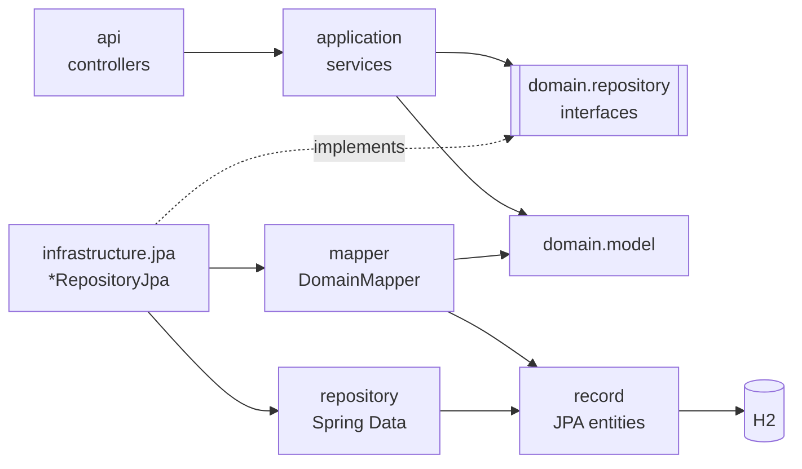
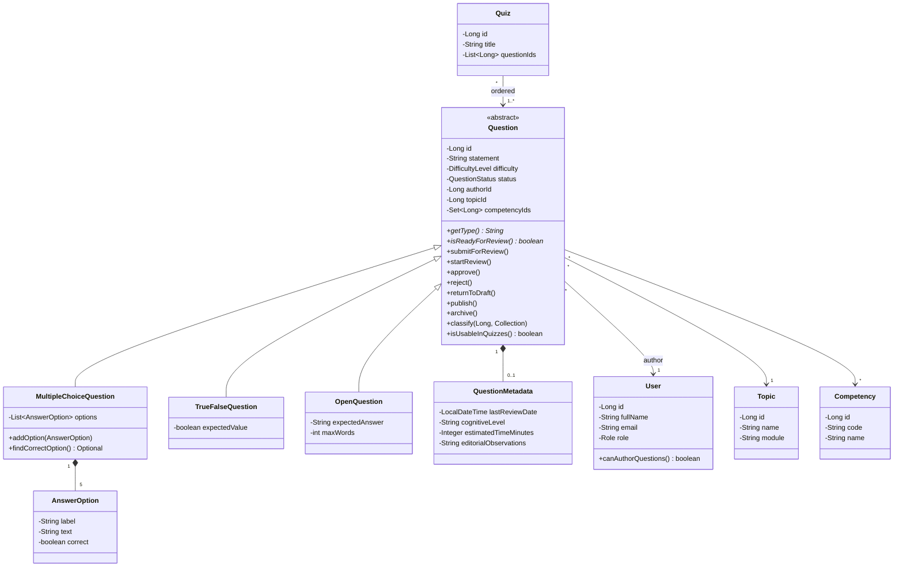
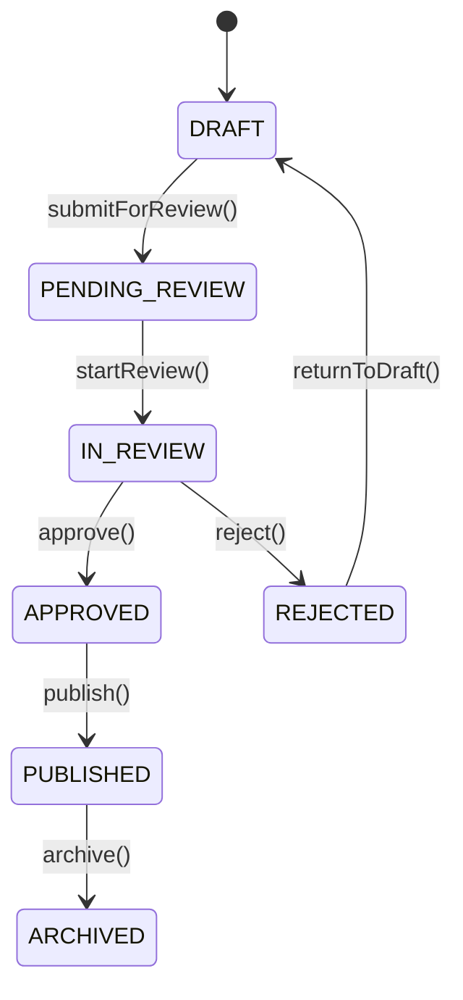
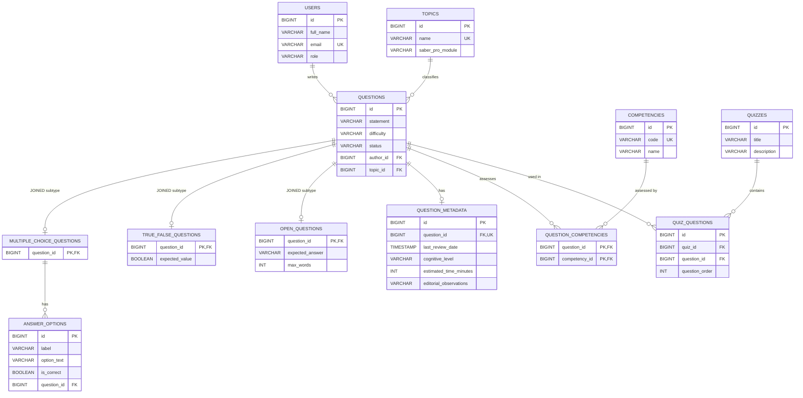

# Saber PRO Question Bank — Persistence with JPA and a Layered Architecture

Workshop 10 · Software Engineering Lab II · Universidad del Cauca (2026.2)
Team: _Member 1_ · _Member 2_ — Group _X_

## Purpose

The Saber PRO Question Bank lets authors write questions, reviewers evaluate them, and teachers build quizzes (mock exams) from published questions. This project implements its persistence layer with Spring Data JPA and H2 while keeping the **domain model free of any JPA annotation**: business classes are plain Java, JPA annotations live only in separate *record* classes, and services depend on technology-independent repository contracts.

## Technology

Java 17 · Spring Boot 3.4.5 · Spring Web · Spring Data JPA / Hibernate · H2 · JUnit 5 · Maven

## Architecture

Layered architecture with dependency inversion at the repository boundary (not hexagonal).

```text
co.edu.unicauca.questionbank
├── api/                        REST controllers and error handling
│   ├── QuestionController, QuizController, CatalogController, ApiExceptionHandler
├── application/                Use cases; depend only on domain repository interfaces
│   ├── QuestionService, ReviewService, QuizService, CatalogService
├── domain/
│   ├── model/                  Plain Java business classes (no JPA, no Spring)
│   └── repository/             Technology-independent contracts
└── infrastructure/jpa/
    ├── record/                 JPA entities (@Entity, @Table, @Id, relationships, inheritance)
    ├── repository/             Spring Data interfaces (JpaRepository)
    ├── mapper/                 DomainMapper: domain <-> record translation
    └── *RepositoryJpa          Concrete implementations of the domain contracts
```



Dependency rules: `api` delegates to `application`; `application` uses repository contracts only (never `JpaRepository`); `domain` contains the model and the contracts; `infrastructure` implements the contracts with Spring Data JPA; the mapper translates between both models.

## Domain model



Question lifecycle (only `PUBLISHED` questions can be used in quizzes):



## Relational model



| Relationship | Mapping |
|---|---|
| `@OneToOne` | `QuestionMetadataRecord.question` owns a NOT NULL, UNIQUE `question_id`; `QuestionRecord.metadata` is the inverse side with cascade and orphan removal |
| `@OneToMany` | `MultipleChoiceQuestionRecord.options` (`mappedBy = "question"`, cascade ALL, orphan removal, ordered by label) |
| `@ManyToOne` | `QuestionRecord.author` and `QuestionRecord.topic`; `AnswerOptionRecord.question` |
| `@ManyToMany` | `QuestionRecord.competencies` through join table `question_competencies` |
| Association entity | `QuizQuestionRecord` (quiz, question, position) with unique keys |
| Inheritance | `QuestionRecord` with `InheritanceType.JOINED`; subtypes use `@PrimaryKeyJoinColumn(name = "question_id")` |

## Running

Requirements: JDK 17+ and Maven 3.8+.

```bash
mvn clean test           # unit and integration tests
mvn spring-boot:run      # API on http://localhost:8080
mvn javadoc:javadoc      # API documentation in target/site/apidocs
```

H2 console: `http://localhost:8080/h2-console` — JDBC URL `jdbc:h2:mem:questionbank`, user `sa`, empty password. Sample data (users, topics, competencies, three questions and one quiz) is loaded on start-up.

## Usage examples

```bash
# Register an author
curl -X POST localhost:8080/api/users -H "Content-Type: application/json" \
  -d '{"fullName":"Luis Gómez","email":"luis@unicauca.edu.co","role":"AUTHOR"}'

# Create a multiple-choice question (five options, one correct)
curl -X POST localhost:8080/api/questions/multiple-choice -H "Content-Type: application/json" \
  -d '{"statement":"¿Cuánto es el 20 % de 150?","difficulty":"LOW","authorId":1,"topicId":1,"competencyIds":[1],
       "options":[{"label":"A","text":"30","correct":true},{"label":"B","text":"20","correct":false},
                  {"label":"C","text":"15","correct":false},{"label":"D","text":"300","correct":false},
                  {"label":"E","text":"3","correct":false}]}'

# Classify, submit and move through the lifecycle
curl -X PUT  localhost:8080/api/questions/4/classification -H "Content-Type: application/json" -d '{"topicId":1,"competencyIds":[1,2]}'
curl -X POST localhost:8080/api/questions/4/submit
curl -X POST localhost:8080/api/questions/4/start-review
curl -X POST localhost:8080/api/questions/4/approve
curl -X POST localhost:8080/api/questions/4/publish

# Queries
curl "localhost:8080/api/questions?authorId=1"
curl "localhost:8080/api/questions?status=PUBLISHED"
curl "localhost:8080/api/questions/published?competencyId=1"

# Build a quiz (409 Conflict if a question is not published)
curl -X POST localhost:8080/api/quizzes -H "Content-Type: application/json" -d '{"title":"Simulacro 2","questionIds":[1,4]}'
```

| Method | Path | Description |
|---|---|---|
| POST/GET | `/api/users`, `/api/topics`, `/api/competencies` | Reference data |
| POST | `/api/questions/multiple-choice`, `/true-false`, `/open` | Create a question |
| GET | `/api/questions?authorId=&status=&topicId=` | List (polymorphic), optionally filtered |
| GET | `/api/questions/published?competencyId=` | Published questions by competency |
| GET | `/api/questions/{id}` | Get one question |
| PUT | `/api/questions/{id}/classification` | Assign topic and competencies |
| PUT | `/api/questions/{id}/metadata` | Add or replace metadata |
| POST | `/api/questions/{id}/submit`, `/start-review`, `/approve`, `/reject`, `/return-to-draft`, `/publish`, `/archive` | Lifecycle |
| DELETE | `/api/questions/{id}` | Delete (409 if used in a quiz) |
| POST/GET | `/api/quizzes`, `/api/quizzes/{id}` | Quizzes |

Errors use RFC 7807 `ProblemDetail`: 400 invalid input, 404 missing resource, 409 business-rule or constraint violation.

## Tests

| Class | Kind | Verifies |
|---|---|---|
| `domain.QuestionTest` | Unit, no Spring | Five-option rule, lifecycle transitions, editing guard, classification, quiz order, roles |
| `domain.DomainPurityTest` | Architecture | No domain file imports JPA or Spring |
| `application.QuestionServiceTest`, `QuizServiceTest` | Unit with in-memory repositories | Use cases work against the contracts without JPA; author/role/topic/competency validation; only published questions in quizzes |
| `infrastructure.jpa.QuestionRepositoryJpaIntegrationTest` | `@DataJpaTest` on H2 | Save/retrieve each type, JOINED tables, one-to-many and orphan removal, many-to-one FKs, many-to-many join table, optional one-to-one, queries, cascading delete, FK and UNIQUE constraints rejecting invalid rows |
| `infrastructure.jpa.QuizRepositoryJpaIntegrationTest` | `@DataJpaTest` on H2 | Question order, unique keys, FK preventing deletion of a question used in a quiz |
| `api.QuestionApiIntegrationTest` | `@SpringBootTest` + MockMvc | Full HTTP flow and 400/404/409 responses |
