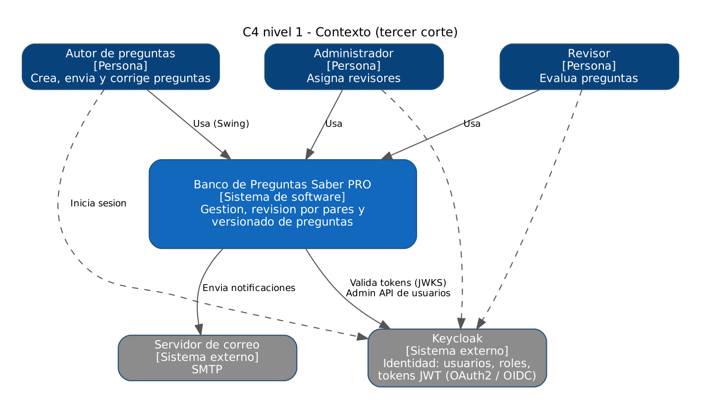
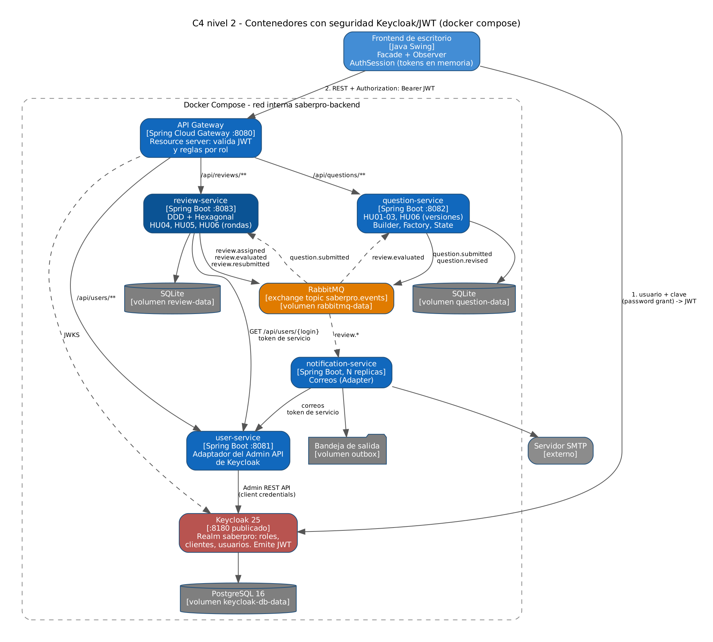
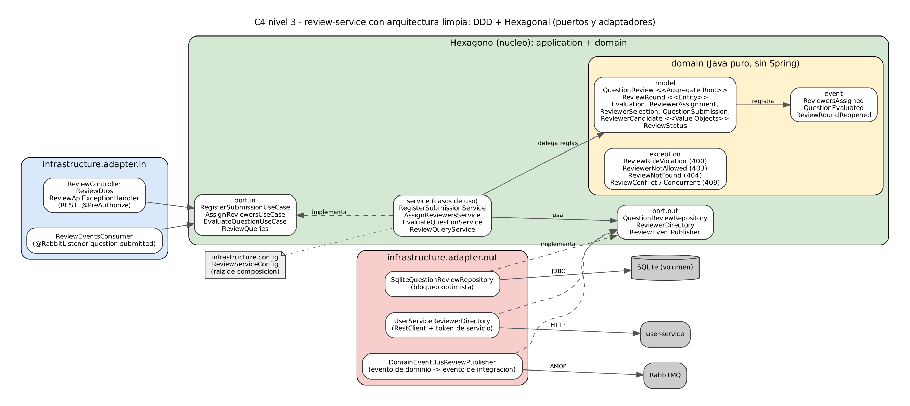
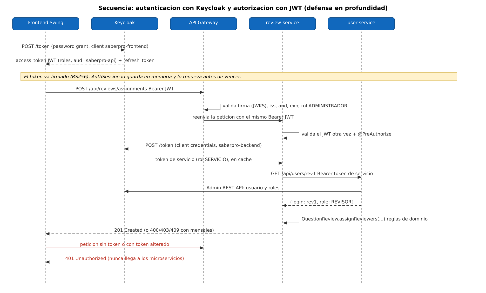
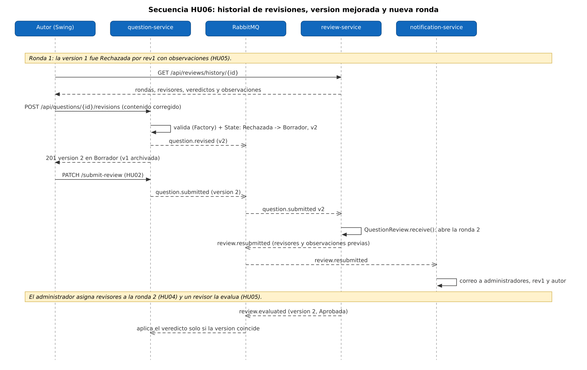
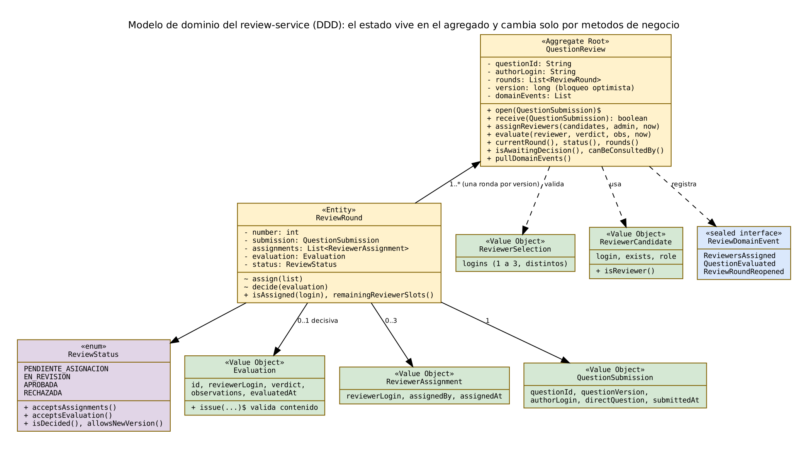
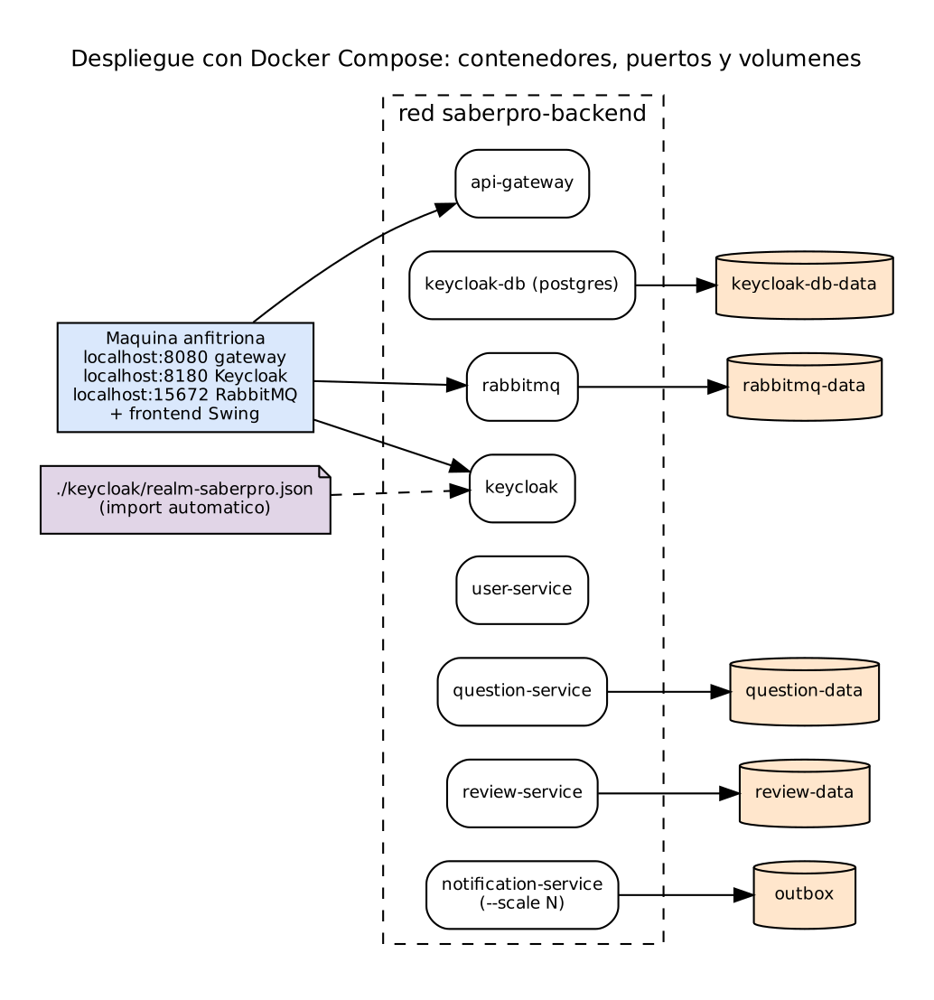

# Portada

**Universidad del Cauca**
Facultad de Ingeniería Electrónica y Telecomunicaciones
Programa de Ingeniería de Sistemas

**Ingeniería de Software II — Teoría y Laboratorio — 2026.2**

## Banco de Preguntas Saber PRO

### Documento de arquitectura — Tercer corte (entrega final)

Microservicios orientados a eventos con **seguridad basada en tokens JWT (Keycloak)**, **arquitectura limpia (DDD + hexagonal)** en el review-service y **despliegue completo con Docker Compose**.

**Integrantes**

| Integrante | Usuario de GitHub |
|------------|-------------------|
| Oscar Alejandro Menza Chavisnan | `drax2311` |
| Santiago Martínez Grajales | `martinezgrasantiago214` |
| Andrés Felipe Florín Burbano | `andresflorin` |

**Docentes:** Paola Andrea Bedoya, Pablo Magé, W. Libardo Pantoja, Julio Hurtado

Popayán, noviembre de 2026

---

# 1. Introducción

El **Banco de Preguntas Saber PRO** permite a los docentes construir preguntas de selección múltiple con única respuesta según el Diseño Centrado en Evidencia, someterlas a una revisión por pares y corregirlas hasta que queden aprobadas.

El sistema se construyó en tres iteraciones, cada una con un atributo de calidad protagonista:

| Corte | Arquitectura | Atributo principal |
|-------|--------------|--------------------|
| 1 | Monolito de escritorio en capas (Swing, MVC, Microkernel, Tuberías y Filtros) | Modificabilidad |
| 2 | Microservicios orientados a eventos (RabbitMQ), frontend separado por API REST y API Gateway | Escalabilidad |
| **3** | **+ Keycloak/JWT, arquitectura limpia (DDD + hexagonal) en review-service, todo dockerizado** | **Seguridad y modificabilidad** |

En este tercer corte:

- Se agrega **HU06**: el autor consulta el **historial de revisiones** con sus observaciones, crea una **versión mejorada** de una pregunta rechazada y la vuelve a enviar a revisión. Se notifica a los implicados.
- **Seguridad:** la autenticación la hace **Keycloak** (servidor de identidad externo). Todos los servicios son *resource servers* OAuth2 que validan el **token JWT**; la autorización es por **roles** (en el gateway y con `@PreAuthorize` en cada servicio) y por **reglas de dominio** (solo el autor edita su pregunta, solo el revisor asignado evalúa, etc.). Los servicios se llaman entre sí con un **token de servicio** (*client credentials*).
- **Arquitectura limpia:** el **review-service**, el de reglas de negocio más ricas, se reorganizó con **DDD** (agregado `QuestionReview`, entidades, objetos de valor, eventos de dominio) y **arquitectura hexagonal** (puertos de entrada y salida, adaptadores). El estado de la revisión dejó de deducirse en el servicio de aplicación y pasó a vivir en el agregado, que solo cambia con **métodos de negocio**.
- **Docker:** `docker compose up --build` levanta Keycloak (con su PostgreSQL), RabbitMQ, los 4 microservicios y el gateway, con **volúmenes** para todas las bases de datos. No hace falta tener Maven ni JDK instalados.

---

# 2. Historias de usuario de las tres iteraciones

Las historias HU01 a HU05 se mantienen (se mejoraron en este corte: el usuario sale del token y no del cuerpo de la petición). HU06 es la nueva. Los criterios siguen el formato *Dado / Cuando / Entonces*.

| HU | Jira | Iteración | Historia | Microservicio(s) | API principal (vía gateway) |
|----|------|-----------|----------|------------------|-----------------------------|
| HU01 | PSP-6 | 1, 2, 3 | Crear preguntas | question-service | `POST /api/questions` |
| HU02 | PSP-8 | 1, 2, 3 | Cambiar el estado a Pendiente de revisión | question-service → review-service | `PATCH /api/questions/{id}/submit-review` |
| HU03 | PSP-9 | 1, 2, 3 | Listar, buscar, filtrar y editar mis preguntas | question-service | `GET /api/questions`, `PUT /api/questions/{id}` |
| HU04 | PSP-11 | 1, 2, 3 | Asignar revisores y notificar | review-service → notification-service | `POST /api/reviews/assignments` |
| HU05 | PSP-44 | 2, 3 | Listar y evaluar preguntas asignadas | review-service → question-service, notification-service | `GET /api/reviews/assignments`, `POST /api/reviews/evaluations` |
| **HU06** | *(Sprint 3)* | **3** | **Historial de revisiones y versión mejorada** | question-service, review-service, notification-service | `GET /api/reviews/history/{id}`, `POST /api/questions/{id}/revisions`, `GET /api/questions/{id}/versions` |

## HU01 — Crear preguntas (autor)

> *Yo como autor de preguntas necesito crear preguntas de selección múltiple con única respuesta acorde a los principios del Diseño Centrado en Evidencia, para alimentar el banco de preguntas Saber PRO.*

| # | Criterio de aceptación |
|---|------------------------|
| CA1 | **Dado** un autor autenticado (rol `AUTOR_PREGUNTAS` en el token), **cuando** abre "Crear pregunta", **entonces** registra contexto, pregunta directa, cuatro opciones, respuesta correcta, justificación, bibliografía, competencia, tema, subtema y nivel de dificultad. |
| CA2 | **Dada** una pregunta válida, **cuando** la guarda, **entonces** queda en **Borrador**, versión 1, a nombre del usuario del token (no del que venga en el JSON). Responde 201 y publica `question.created`. |
| CA3 | **Dada** una pregunta inválida, **entonces** se aplica la **validación estructural** y se responde **400 con todos los errores juntos**. |
| CA4 | Un usuario sin rol de autor recibe **403**; sin token, **401**. |

## HU02 — Cambiar el estado de la pregunta (autor)

> *Yo como autor de preguntas necesito cambiar el estado de mis preguntas de "Borrador" a "Pendiente de revisión" para que el administrador les asigne al menos un revisor.*

| # | Criterio de aceptación |
|---|------------------------|
| CA1 | **Borrador** es el estado inicial. Los estados se ven con colores y una leyenda. |
| CA2 | **Dada** una pregunta propia en Borrador, **cuando** el autor la envía, **entonces** pasa a **Pendiente de revisión** y se publica `question.submitted` con su **número de versión**. |
| CA3 | Si quien la envía no es su autor: **403**. Si no está en Borrador: el patrón State lo impide y responde **409**. |

## HU03 — Listar las preguntas creadas (autor)

> *Yo como autor de preguntas necesito listar las preguntas que he creado para poder más adelante verlas y editarlas.*

| # | Criterio de aceptación |
|---|------------------------|
| CA1 | El autor ve **solo sus** preguntas (el servicio fuerza el filtro de autor con el usuario del token, aunque pida las de otro). |
| CA2 | Búsqueda por palabra clave, filtros por estado y tema, **paginación** (máximo 50 por página). |
| CA3 | Puede ver el detalle (con la versión) y **editar** solo sus Borradores: 403 si no es el autor, 409 si no está en Borrador. |

## HU04 — Asignar revisores (administrador)

> *Yo como administrador necesito asignar revisores (entre 1 y 3) de las preguntas en estado "Pendiente de revisión" para que las preguntas sean revisadas por otros docentes. Una vez asignados, el sistema enviará un email para que sean notificados.*

| # | Criterio de aceptación |
|---|------------------------|
| CA1 | El administrador (rol `ADMINISTRADOR`) ve las preguntas que esperan veredicto, con su **ronda** y **versión**. |
| CA2 | Asigna **entre 1 y 3** revisores distintos **por ronda**, que existan en Keycloak con rol `REVISOR` y que no sean el autor. Si algo falla responde **400 con todos los errores**; si la ronda ya tiene veredicto, **409**. |
| CA3 | El administrador que asigna se toma del token. Se publica `review.assigned` y se envía un correo a cada revisor. |

## HU05 — Listar y evaluar preguntas asignadas (revisor)

> *Yo como revisor de preguntas necesito listar las preguntas que me han sido asignadas por el administrador para poder leerlas, dejar la evaluación y cambiar el estado a Aprobada/Rechazada. El revisor puede dejar observaciones para el autor. El sistema notifica a los implicados.*

| # | Criterio de aceptación |
|---|------------------------|
| CA1 | El revisor ve **solo sus** asignaciones (403 si pide las de otro), indicando si aún puede evaluarlas (ronda vigente). |
| CA2 | Veredicto **Aprobada** o **Rechazada**; al rechazar las **observaciones** son obligatorias (máximo 2000 caracteres). |
| CA3 | Solo evalúa un revisor **asignado a la ronda actual** (403 en otro caso). El primero que evalúa decide la ronda; después, **409**. |
| CA4 | Se publica `review.evaluated` con la versión: el question-service cambia el estado y el notification-service avisa al autor y a los administradores. |

## HU06 — Historial de revisiones y versión mejorada (autor) — *nueva*

> *Yo como autor de preguntas necesito listar y ver el historial de revisiones y sus observaciones para poder sacar una versión mejorada de la pregunta y cambiar de estado. El sistema debe enviar notificaciones a los implicados.*

| # | Criterio de aceptación |
|---|------------------------|
| CA1 | **Dada** una pregunta propia, **cuando** el autor abre "Historial de revisiones", **entonces** ve **una ronda por versión** con: fecha de envío, revisores asignados (y quién los asignó), veredicto, revisor que decidió, fecha y **observaciones**. También ve el contenido de las **versiones anteriores**. |
| CA2 | El historial solo lo ven el **autor**, los **administradores** y quienes hayan sido **revisores** de la pregunta (403 para los demás; 404 si nunca se envió a revisión). |
| CA3 | **Dada** una pregunta **Rechazada**, **cuando** el autor pulsa "Crear versión mejorada", **entonces** el formulario se abre precargado y muestra las observaciones del último rechazo. |
| CA4 | Al guardar, el contenido pasa por la misma validación estructural de HU01 (400). Solo desde **Rechazada** (409 en otro estado, patrón State) y solo el **autor** (403). |
| CA5 | La pregunta conserva su id, sube a la **versión n+1** y vuelve a **Borrador**; la versión anterior queda **archivada**. Se publica `question.revised`. |
| CA6 | **Cuando** el autor la envía otra vez a revisión (HU02), el review-service abre la **ronda n+1** (la ronda anterior queda en el historial) y la pregunta vuelve a la lista del administrador. Se publica `review.resubmitted`. |
| CA7 | **Notificaciones:** los **administradores** reciben un correo para asignar revisores a la nueva versión, los **revisores de la ronda anterior** reciben un aviso con sus observaciones, y el **autor** una confirmación. Cada persona recibe un solo correo aunque tenga varios papeles. |
| CA8 | Un veredicto atrasado de una versión anterior (p. ej. reentregado por RabbitMQ) **no** cambia el estado de la versión actual. |

## Requisitos no funcionales del tercer corte

| # | Requisito | Cómo se cumple |
|---|-----------|----------------|
| RNF1 | Autenticación y autorización con tokens JWT y un sistema externo (Keycloak). Gestión de usuarios y roles por Postman. | Realm `saberpro` importado automáticamente; gateway y servicios validan el JWT; roles `ADMINISTRADOR`, `AUTOR_PREGUNTAS`, `REVISOR` y `SERVICIO`; carpeta 1 de la colección Postman (Admin REST API). Sección 6. |
| RNF2 | Arquitectura limpia (DDD y/o hexagonal) en un microservicio con reglas de dominio. | review-service con DDD + hexagonal, verificado con pruebas de arquitectura (ArchUnit). Sección 7. |
| RNF3 | Dockerizar los microservicios con Docker Compose. | `Dockerfile` multi-etapa y `docker-compose.yml` con 9 contenedores, *healthchecks* y 5 volúmenes. Sección 8. |
| RNF4 | Documento final en PDF y repositorio documentado. | Este documento (`docs/Documento-Arquitectura-Tercer-Corte.pdf`) y el `README.md`. |

---

# 3. Planificación de los Sprints 1, 2 y 3

**Sprint 1** (*PSP Sprint 1*, 18 sep – 2 oct de 2026) y **Sprint 2** (9 – 30 oct de 2026) están en Jira, proyecto *Pruebas Saber Pro* (PSP).

> **[Pegar aquí el pantallazo del tablero del Sprint 1 en Jira]**
>
> **[Pegar aquí el pantallazo del tablero del Sprint 2 en Jira]**

| Historia | Resumen | Responsable | Subtareas | Sprint | Estado |
|----------|---------|-------------|-----------|--------|--------|
| PSP-6 | HU01 Crear preguntas | Oscar Menza | PSP-14 a PSP-19 | 1 → 2 | Listo |
| PSP-8 | HU02 Cambiar estado de la pregunta | Santiago Martínez | PSP-20 a PSP-23 | 1 → 2 | Listo |
| PSP-9 | HU03 Listar preguntas creadas | Santiago Martínez | PSP-24 a PSP-29 | 1 → 2 | Listo |
| PSP-11 | HU04 Asignar revisores | Andrés Florín | PSP-30 a PSP-35 | 1 → 2 | Listo |
| PSP-44 | HU05 Listar y evaluar preguntas asignadas | Oscar Menza | PSP-45 a PSP-50 | 2 | Listo |

**Sprint 3** (propuesto: 3 – 24 nov de 2026). Objetivo: *HU06, seguridad con Keycloak, arquitectura limpia y despliegue con Docker.* Tareas a registrar en Jira:

> **[Pegar aquí el pantallazo del tablero del Sprint 3 en Jira]**

| Historia / tarea | Subtareas sugeridas | Responsable sugerido |
|------------------|---------------------|----------------------|
| HU06 Historial y versión mejorada | Versionado de la pregunta y estado `startRevision` (question-service); rondas e historial en el agregado (review-service); notificación `review.resubmitted`; pantallas "Historial de revisiones" y "Crear versión mejorada"; pruebas | Oscar Menza |
| RNF1 Seguridad Keycloak/JWT | Realm y clientes; resource server en gateway y servicios; `@PreAuthorize`; token de servicio; login del frontend con Keycloak; colección Postman | Santiago Martínez |
| RNF2 Arquitectura limpia en review-service | Agregado, objetos de valor y eventos de dominio; puertos y adaptadores; pruebas de dominio y ArchUnit | Andrés Florín |
| RNF3 Docker Compose | Dockerfile multi-etapa; compose con Keycloak, PostgreSQL, RabbitMQ y volúmenes; *healthchecks* | Andrés Florín |
| RNF4 Documentación | Documento final, diagramas C4, README | Todos |

---

# 4. Escenarios de calidad

## 4.1 Modificabilidad — cambiar una regla de revisión sin tocar la infraestructura

**Contexto.** La coordinación Saber PRO cambia con frecuencia sus políticas de revisión (cuántos revisores, quién decide, cuándo se puede reenviar). En el segundo corte esas reglas estaban repartidas en el servicio de aplicación del review-service (mezcladas con consultas al repositorio y llamadas HTTP), y el estado "pendiente" se deducía de si había evaluaciones guardadas.

| Parte | Descripción |
|-------|-------------|
| **Fuente del estímulo** | Coordinación académica (cliente). |
| **Estímulo** | Cambiar una regla de negocio de la revisión, p. ej. *"una pregunta puede tener hasta 5 revisores por ronda"* o *"se requieren 2 aprobaciones para aprobar"*. |
| **Artefacto** | review-service: capa de dominio (`QuestionReview`, `ReviewRound`, `ReviewerSelection`, `ReviewStatus`). |
| **Entorno** | Tiempo de desarrollo. |
| **Respuesta** | El cambio se hace solo en el **dominio** (Java puro). No se modifican controladores, consumidores de RabbitMQ, repositorio SQLite, clientes HTTP ni otros microservicios; el contrato de eventos (`common`) no cambia. |
| **Medida de la respuesta** | (1) Clases modificadas: **1 o 2, todas en `domain`**. (2) **0 cambios** en `infrastructure` y en otros microservicios. (3) Las pruebas de dominio del cambio corren en **menos de 1 segundo**, sin Spring, base de datos ni broker. (4) Las pruebas de **ArchUnit** siguen pasando (el dominio no depende de frameworks). |
| **Resultado esperado** | Las reglas de negocio evolucionan de forma aislada, rápida y verificable, que es la promesa de la arquitectura limpia. |

**Tácticas:** encapsular el estado en el agregado (sin *setters*), objetos de valor que solo existen válidos, puertos (DIP) para persistencia/directorio/eventos, raíz de composición única (`ReviewServiceConfig`), pruebas de arquitectura automáticas.

## 4.2 Escalabilidad — pico de asignaciones y correos

| Parte | Descripción |
|-------|-------------|
| **Fuente del estímulo** | Administradores y revisores trabajando a la vez durante una convocatoria. |
| **Estímulo** | Pico de **500 asignaciones en 10 minutos**, cada una con hasta 3 revisores: hasta **1.500 correos**, más los de evaluaciones y reenvíos (HU06). |
| **Artefacto** | notification-service y sus colas en RabbitMQ; review-service. |
| **Entorno** | Operación normal con `docker compose`. |
| **Respuesta** | La API responde sin esperar los correos (se procesan de forma asíncrona). Si la cola crece: `docker compose up -d --scale notification-service=3`; las réplicas compiten por los mensajes de la misma cola. Los servicios son *stateless* también en seguridad: cada petición trae su JWT, no hay sesión en servidor, cualquier réplica la atiende. |
| **Medida de la respuesta** | (1) `POST /api/reviews/assignments` < **500 ms** (p95) durante el pico. (2) Con 3 réplicas, la cola se vacía en **≈ 1/3** del tiempo. (3) **0 mensajes perdidos** (colas y volumen de RabbitMQ durables). (4) Dos asignaciones simultáneas sobre la misma pregunta nunca superan 3 revisores (bloqueo optimista del agregado, 409 al perdedor). |
| **Resultado esperado** | El sistema absorbe el pico y la capacidad crece agregando réplicas. |

## 4.3 Seguridad — acceso no autorizado

| Parte | Descripción |
|-------|-------------|
| **Fuente** | Usuario malintencionado o cliente con token vencido/alterado. |
| **Estímulo** | Petición sin token, con firma falsa, o de un rol que no corresponde (p. ej. un autor que intenta asignar revisores o evaluar). |
| **Artefacto** | API Gateway y microservicios. |
| **Respuesta** | El gateway rechaza con **401** sin enrutar; los roles insuficientes reciben **403** en el gateway y otra vez en el servicio (`@PreAuthorize`); las reglas de propiedad (autor, revisor asignado) las decide el dominio. Keycloak bloquea temporalmente la cuenta tras 5 intentos fallidos. |
| **Medida** | **100 %** de las peticiones sin token válido rechazadas (carpeta 3 de Postman). Ninguna operación acepta el login enviado en el cuerpo. Tokens de acceso de **15 minutos**. |

---

# 5. Arquitectura y diseño (modelo C4)

Los diagramas del tercer corte están en [`docs/diagramas/tercer-corte/`](diagramas/tercer-corte) (fuente Graphviz `.dot` / JSON y su `.png`). Los del segundo corte siguen en [`docs/diagramas/`](diagramas) y su documento en [`docs/segundo-corte/`](segundo-corte).

## 5.1 Nivel 1 — Contexto

Aparece un sistema externo nuevo: **Keycloak**, que autentica a los usuarios y emite los tokens.



## 5.2 Nivel 2 — Contenedores (segunda iteración + seguridad de la tercera)



| Contenedor | Puerto | Responsabilidad | Publica | Consume |
|------------|--------|-----------------|---------|---------|
| frontend (Swing) | — | Pantallas por rol; login con Keycloak; envía `Bearer JWT` | — | — |
| **keycloak** + PostgreSQL | 8180 | Usuarios, roles, clientes; emite y firma JWT | — | — |
| api-gateway | 8080 | Única entrada; **valida JWT y roles**; Swagger unificado | — | — |
| user-service | interno 8081 | Adaptador del **Admin API de Keycloak** (consulta y registro) | — | — |
| question-service | interno 8082 | HU01–HU03, versiones (HU06), estados | `question.created`, `question.submitted`, `question.revised` | `review.evaluated` |
| review-service | interno 8083 | HU04, HU05, rondas e historial (HU06) — **DDD + hexagonal** | `review.assigned`, `review.evaluated`, `review.resubmitted` | `question.submitted` |
| notification-service | interno | Correos de HU04, HU05 y HU06 (N réplicas) | — | `review.assigned`, `review.evaluated`, `review.resubmitted` |
| RabbitMQ | 15672 | Broker de eventos (exchange *topic* `saberpro.events`) | — | — |

Cambio respecto al segundo corte: el user-service **ya no guarda contraseñas** ni tiene base de datos (antes: SQLite + PBKDF2). Keycloak es la única fuente de verdad de identidad.

## 5.3 Nivel 3 — Componentes del review-service (arquitectura limpia)



Los demás servicios conservan la organización por paquetes del segundo corte (`web`, `messaging`, `application`, `domain`, `access`, `config`); ver [`docs/segundo-corte/`](segundo-corte/ARQUITECTURA-segundo-corte.md).

## 5.4 Vista dinámica: seguridad (Keycloak + JWT)



## 5.5 Vista dinámica: HU06



---

# 6. Seguridad: Keycloak y JWT

## 6.1 Realm `saberpro` (se crea solo)

El archivo [`keycloak/realm-saberpro.json`](../keycloak/realm-saberpro.json) se importa al primer arranque del contenedor (`start-dev --import-realm`); Keycloak guarda todo en su PostgreSQL (volumen `keycloak-db-data`).

| Elemento | Valor |
|----------|-------|
| Roles del realm | `ADMINISTRADOR`, `AUTOR_PREGUNTAS`, `REVISOR` (negocio) y `SERVICIO` (técnico) |
| Cliente `saberpro-frontend` | **Público** (sin secreto). Lo usa el frontend Swing con usuario y clave (*password grant*); PKCE habilitado para un futuro cliente web. |
| Cliente `saberpro-backend` | **Confidencial** con *service account* (rol `SERVICIO` y roles `view-users`, `query-users`, `manage-users`, `view-realm` de `realm-management`). Lo usan los microservicios para llamarse entre sí y para el Admin API. |
| Audiencia | *Mapper* `oidc-audience-mapper` en ambos clientes: los tokens llevan `aud = saberpro-api`, que los servicios exigen. |
| Políticas | Clave: mínimo 6, un dígito, una mayúscula, un carácter especial. Bloqueo tras 5 intentos fallidos. Token de acceso: 15 min. |
| Usuarios de prueba | `admin/Admin123!`, `autor1/Autor123!`, `autor2/Autor123!`, `rev1`, `rev2`, `rev3` (`Revisor123!`). |

## 6.2 Flujo y validación del token

1. El frontend envía usuario y clave **solo a Keycloak** y recibe el `access_token` (JWT firmado RS256) y el `refresh_token`. `AuthSession` los guarda en memoria y renueva el de acceso 30 s antes de que venza.
2. Cada petición al gateway lleva `Authorization: Bearer <JWT>`.
3. El **gateway** (WebFlux) valida firma (JWKS del realm), emisor, audiencia y vigencia, y aplica reglas por rol (`GatewaySecurityConfig`). Sin token: **401** y la petición no llega a los servicios.
4. Cada **microservicio** vuelve a validar el token (`ResourceServerSecurityConfig`, compartida en `common`) y aplica `@PreAuthorize` por caso de uso. `KeycloakJwtAuthenticationConverter` convierte `realm_access.roles` en autoridades `ROLE_*` y usa `preferred_username` como nombre.
5. El **usuario de la operación sale del token** (`CurrentUserProvider`), nunca del JSON: nadie puede crear, editar, asignar o evaluar a nombre de otro.
6. Para llamar a otro servicio (review → user, notification → user), el servicio pide su propio token con *client credentials* (`ServiceTokenProvider`, en caché hasta 30 s antes de vencer) y lo agrega con un interceptor del `RestClient`.

Configuración de Docker: Keycloak publica el emisor `http://localhost:8180` (`KC_HOSTNAME`) y resuelve el *backchannel* de forma dinámica, así los contenedores descargan las llaves y piden tokens por `http://keycloak:8080` mientras validan el mismo emisor que usa el frontend.

## 6.3 Matriz de autorización

| Operación | Rol (gateway y `@PreAuthorize`) | Regla de dominio adicional |
|-----------|-------------------------------|----------------------------|
| Crear / editar / enviar / versión mejorada de pregunta | `AUTOR_PREGUNTAS` | Solo el autor; estados según patrón State |
| Listar preguntas | autenticado | Un autor solo ve las suyas |
| Ver pregunta | autenticado | Autor, administradores o revisores |
| Pendientes / asignar revisores | `ADMINISTRADOR` | 1–3 revisores con rol REVISOR, nunca el autor |
| Evaluar | `REVISOR` | Asignado a la ronda vigente; una sola decisión por ronda |
| Mis asignaciones | `REVISOR` o `ADMINISTRADOR` | Un revisor solo consulta las suyas |
| Historial de revisiones | autenticado | Autor, administradores o revisores de la pregunta |
| Consultar usuario | `ADMINISTRADOR`, `SERVICIO` o el mismo usuario | — |
| Registrarse | público | El rol Administrador solo lo da un administrador |

## 6.4 Gestión de usuarios y roles por Postman

La carpeta **"1. Gestión de usuarios y roles en Keycloak"** de la colección obtiene un token del administrador de Keycloak y usa el Admin REST API para listar usuarios y roles, **crear un usuario**, buscar su id y **asignarle un rol**.

---

# 7. Arquitectura limpia en el review-service: DDD + hexagonal

## 7.1 Por qué este microservicio

El review-service concentra las reglas más ricas del negocio: 1 a 3 revisores, nunca el autor, solo revisores, primer veredicto decide, rechazo con observaciones, y ahora rondas por versión (HU06). En el segundo corte esas reglas estaban en `ReviewApplicationService` mezcladas con el repositorio y HTTP, las entidades eran datos sin comportamiento (**modelo anémico**) y el estado se calculaba así:

```java
// Segundo corte: el estado "pendiente" se deducia
// en el servicio de aplicacion
.filter(q -> repository.findEvaluationsByQuestion(q.questionId())
                       .isEmpty())
```

## 7.2 Del atributo de estado a métodos de negocio

Ahora el estado es parte del agregado y **solo cambia con métodos que expresan el negocio**; no hay *setters*:

```java
// ronda 1: PENDIENTE_ASIGNACION
QuestionReview review = QuestionReview.open(submission);
// -> EN_REVISION (valida todas las reglas de HU04)
review.assignReviewers(candidates, "admin", now);
// -> RECHAZADA (el primer veredicto decide la ronda)
review.evaluate("rev1", RECHAZADA, "Citar la fuente", now);
// HU06: la version 2 abre la ronda 2
review.receive(submissionVersion2);
// ReviewersAssigned, QuestionEvaluated, ReviewRoundReopened
review.pullDomainEvents();
```

Cada estado sabe qué permite (`ReviewStatus.acceptsAssignments()`, `acceptsEvaluation()`, `allowsNewVersion()`), en lugar de `if` repartidos.



## 7.3 Bloques tácticos de DDD

| Bloque | Clase(s) | Responsabilidad |
|--------|----------|-----------------|
| Raíz de agregado | `QuestionReview` | Frontera de consistencia: todas las reglas de HU04, HU05 y HU06; registra los eventos de dominio. |
| Entidad | `ReviewRound` | Una ronda por versión, con identidad (número); su estado solo lo cambia el agregado (métodos de paquete). |
| Objetos de valor | `Evaluation`, `ReviewerAssignment`, `ReviewerSelection`, `QuestionSubmission`, `ReviewerCandidate` | Inmutables y válidos desde su creación (p. ej. `ReviewerSelection` no existe con 4 revisores; `Evaluation.issue` exige observaciones al rechazar). |
| Eventos de dominio | `ReviewersAssigned`, `QuestionEvaluated`, `ReviewRoundReopened` (interfaz *sealed*) | Hechos del negocio; el adaptador los traduce a eventos de integración (`common`). |
| Repositorio | `QuestionReviewRepository` (puerto) | Guarda y lee el **agregado completo**, con **bloqueo optimista** (`version`). |
| Excepciones de dominio | `ReviewRuleViolation`, `ReviewerNotAllowed`, `ReviewNotFound`, `ReviewConflict`, `ConcurrentReviewUpdate` | El dominio no conoce HTTP; el adaptador web las traduce a 400/403/404/409. |
| Lenguaje ubicuo | ronda, versión, veredicto, asignación, reenvío | Los nombres del código son los del negocio. |

## 7.4 Puertos y adaptadores (hexagonal)

| Capa | Paquete | Contenido | Depende de |
|------|---------|-----------|-----------|
| Dominio | `review.domain` | modelo, eventos, excepciones | solo Java y los enums de `common.contract` |
| Aplicación | `review.application.port.in` | `RegisterSubmissionUseCase`, `AssignReviewersUseCase`, `EvaluateQuestionUseCase`, `ReviewQueries` | dominio |
| | `review.application.port.out` | `QuestionReviewRepository`, `ReviewerDirectory`, `ReviewEventPublisher` | dominio |
| | `review.application.service` | Un caso de uso por clase: cargar → delegar en el agregado → guardar → publicar | puertos |
| Infraestructura | `infrastructure.adapter.in.web` | `ReviewController` (REST + `@PreAuthorize`), DTOs, manejador de errores | puertos de entrada |
| | `infrastructure.adapter.in.messaging` | `ReviewEventsConsumer` (`question.submitted`) | puertos de entrada |
| | `infrastructure.adapter.out.persistence` | `SqliteQuestionReviewRepository` | puerto de salida |
| | `infrastructure.adapter.out.directory` | `UserServiceReviewerDirectory` (HTTP + token de servicio) | puerto de salida |
| | `infrastructure.adapter.out.events` | `DomainEventBusReviewPublisher` (Observer → RabbitMQ) | puerto de salida |
| | `infrastructure.config` | `ReviewServiceConfig`: **raíz de composición**, único lugar que une puertos y adaptadores | todo |

La regla de dependencias se **verifica en cada build** con `HexagonalArchitectureTest` (ArchUnit): las capas solo dependen hacia adentro, y `domain` y `application` no pueden importar Spring, JDBC, Jackson, SLF4J ni los paquetes técnicos de `common`.

## 7.5 Esquema de persistencia del agregado

| Tabla | Clave | Parte del agregado |
|-------|-------|--------------------|
| `review_case` | `questionId` | Raíz + `version` (bloqueo optimista) |
| `review_round` | `(questionId, roundNumber)` | Rondas, con versión de la pregunta y estado |
| `round_assignment` | `(questionId, roundNumber, reviewerLogin)` | Asignaciones (solo se agregan) |
| `round_evaluation` | `id`, `UNIQUE(questionId, roundNumber)` | Un veredicto por ronda |

Cada guardado es una transacción: `UPDATE review_case ... WHERE version = ?`; si otra operación guardó antes, no se actualiza ninguna fila, se deshace todo y se responde 409.

---

# 8. Despliegue con Docker Compose y volúmenes



- **`Dockerfile` multi-etapa:** la etapa `build` (imagen `maven:3.9-eclipse-temurin-17`) compila todo el backend con una caché de dependencias de BuildKit; la etapa `runtime` (`eclipse-temurin:17-jre`) solo lleva el jar y corre con un **usuario sin privilegios**. La etapa de compilación es idéntica para todos los servicios, así que Docker la ejecuta una vez.
- **`docker-compose.yml`:** 9 contenedores en la red `saberpro-backend`. Solo se publican el gateway (8080), Keycloak (8180) y la consola de RabbitMQ (15672); los microservicios solo son alcanzables a través del gateway.
- **Orden de arranque con *healthchecks*:** PostgreSQL → Keycloak (`/health/ready`) → servicios (`/actuator/health`) → gateway.
- **Configuración por variables de entorno** (`.env.example`): URLs de Keycloak, secreto del cliente de servicio, credenciales de RabbitMQ.

| Volumen | Contenedor | Contenido |
|---------|------------|-----------|
| `keycloak-db-data` | keycloak-db | PostgreSQL de Keycloak: usuarios, roles, clientes |
| `question-data` | question-service | `question-service.db` (preguntas y versiones archivadas) |
| `review-data` | review-service | `review-service.db` (revisiones, rondas, asignaciones, evaluaciones) |
| `rabbitmq-data` | rabbitmq | Colas durables |
| `outbox` | notification-service | Correos no enviados por SMTP |

**Evidencia** (pegar los pantallazos al ejecutar):

```bash
docker compose up --build -d
docker compose ps     # todos "running (healthy)"
docker volume ls      # banco-preguntas-saberpro_question-data, ...
docker compose down && docker compose up -d   # los datos siguen
```

> **[Pegar aquí el pantallazo de `docker compose ps`]**
>
> **[Pegar aquí el pantallazo de `docker volume ls` y de Docker Desktop]**

---

# 9. Patrones de diseño implementados

## 9.1 Patrones GoF

| Patrón | Tipo | Contexto del problema | Dónde |
|--------|------|------------------------|-------|
| **Builder** | Creacional | Una pregunta tiene 17 atributos; se construye al crear, editar, leer de la BD y al sacar una versión mejorada. | `Question.builder()` (question-service). `reviseWith` lo usa para crear la versión n+1. |
| **Factory Method** | Creacional | Varios tipos de pregunta, cada uno con su validación. | `QuestionFactory` y subclases, cargadas por reflexión en `QuestionFactoryRegistry`. HU06 reutiliza la validación del tipo. |
| **Adapter** | Estructural | Enviar correos sin depender de la librería; cambiar a bandeja local. | `SmtpEmailChannelAdapter`, `OutboxFileChannel` (notification-service). En el review-service, cada adaptador hexagonal adapta una tecnología a un puerto. |
| **Facade** | Estructural | El frontend no debe conocer 3 servicios, Keycloak, JSON ni tokens. | `BancoPreguntasFacade` (ahora con `reviseQuestion`, `reviewHistory`). |
| **State** | Comportamiento | Reglas del ciclo de vida de la pregunta. | `QuestionState` y 5 estados; HU06 agrega `startRevision()` (solo `RechazadaState` lo permite) e `isRevisable()`. |
| **Observer** | Comportamiento | Publicar eventos sin saber quién escucha; refrescar pantallas. | `DomainEventBus` + `RabbitEventForwarder`; `Subject`/`Observer` en el frontend. |

## 9.2 Patrones de arquitectura y de DDD

| Patrón | Dónde |
|--------|-------|
| Microservicios, API Gateway, Base de datos por servicio | Todo el backend |
| Arquitectura orientada a eventos, Consumidores competidores | RabbitMQ, notification-service escalable |
| **Arquitectura hexagonal (puertos y adaptadores)** | review-service |
| **Agregado, Entidad, Objeto de valor, Evento de dominio, Repositorio** (DDD táctico) | review-service |
| Raíz de composición | `ReviewServiceConfig` |
| Bloqueo optimista | `SqliteQuestionReviewRepository` |
| Consumidor idempotente | `applyEvaluation` (por versión), `QuestionReview.receive` |
| Published Language / Anticorruption | eventos de `common`; `DomainEventBusReviewPublisher` traduce eventos de dominio a eventos de integración |
| Token Relay / Client Credentials (OAuth2) | gateway → servicios; servicio → servicio |
| Tuberías y Filtros, MVC, DTO | `QuestionPipeline`, frontend, controladores |

## 9.3 Principios SOLID

| Principio | Aplicación en este corte |
|-----------|--------------------------|
| SRP | Un caso de uso por clase en el review-service; el agregado decide, el servicio orquesta, el adaptador traduce. |
| OCP | Nuevos canales, estados o adaptadores (p. ej. cambiar SQLite por PostgreSQL) sin tocar el dominio. |
| LSP | Cualquier implementación de `QuestionReviewRepository` (SQLite o la de memoria de las pruebas) es intercambiable. |
| ISP | Puertos pequeños: `ReviewerDirectory` (1 método), `ReviewEventPublisher` (1), `CurrentUserProvider` (1). |
| DIP | El dominio y la aplicación definen interfaces; la infraestructura las implementa. Verificado con ArchUnit. |

---

# 10. Pruebas unitarias automatizadas

`mvn test` ejecuta **247 pruebas** JUnit 5. No necesitan Keycloak, RabbitMQ ni servidor de correo: el usuario autenticado se simula con un doble de `CurrentUserProvider`, y los puertos con dobles en memoria.

| Módulo | Pruebas | Clases |
|--------|---------|--------|
| common | 27 | `ContractEnumsTest`, `QuestionFieldTest`, `DomainEventBusTest`, **`KeycloakClaimsTest`**, **`ServiceTokenProviderTest`** |
| user-service | 19 | `UserTest`, `UserServiceTest`, `PasswordPolicyTest`, **`KeycloakMappingTest`** |
| question-service | 100 | Builder, Factory, Pipeline, State, casos de uso HU01–HU03, **`QuestionVersioningTest`**, **`ReviseQuestionTest`** (HU06), repositorio SQLite y controladores con el usuario del token |
| review-service | 53 | **`QuestionReviewTest`** (agregado), **`ValueObjectsTest`**, **`ReviewUseCasesTest`**, **`SqliteQuestionReviewRepositoryTest`**, **`DomainEventBusReviewPublisherTest`**, **`ReviewControllerTest`**, **`HexagonalArchitectureTest`** (ArchUnit) |
| notification-service | 19 | `NotificationServiceTest` (incluye avisos de HU06), `NotificationChannelsTest` |
| frontend | 29 | `BancoPreguntasFacadeTest`, `ApiClientTest` (header Bearer, 401), **`KeycloakAuthClientTest`** (login, refresh, logout contra un Keycloak simulado), **`ReviewHistoryFormatterTest`**, otras |

Todas las **entidades y servicios de dominio** tienen pruebas: `QuestionReview`, `ReviewRound`, los 5 objetos de valor, `ReviewStatus`, `Question` (con versionado), los estados, las fábricas, los filtros, `User`, `UserService`, la política de contraseñas y `NotificationService`.

La colección [`postman/BancoPreguntas-API.postman_collection.json`](../postman/BancoPreguntas-API.postman_collection.json) (56 peticiones con aserciones) recorre: tokens de cada rol, gestión de usuarios en Keycloak, pruebas de seguridad (401/403) y el flujo completo HU01 → HU06 con dos rondas de revisión.

---

# 11. Cómo ejecutar

```bash
# Keycloak + PostgreSQL + RabbitMQ + 4 servicios + gateway
docker compose up --build -d
# escenario de escalabilidad
docker compose up -d --scale notification-service=3
# frontend de escritorio
mvn -pl frontend -am package -DskipTests
java -jar frontend/target/frontend-3.0.0.jar
```

| Recurso | URL |
|---------|-----|
| API Gateway y Swagger UI (botón *Authorize* para el JWT) | http://localhost:8080/swagger-ui.html |
| Consola de Keycloak | http://localhost:8180/admin (admin / admin) |
| Consola de RabbitMQ | http://localhost:15672 (guest / guest) |

---

# 12. Enlaces

- **Repositorio Git:** https://github.com/martinezgrasantiago214/BANCO_PREGUNTAS_SABER_PRO
- **Tablero (Jira):** https://ingsoft2asa.atlassian.net (proyecto PSP)
- **Documentos anteriores:** [primer corte](primer-corte/ARQUITECTURA-primer-corte.md), [segundo corte](segundo-corte/ARQUITECTURA-segundo-corte.md)
